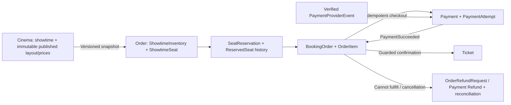

# Booking reliability persistence

## Ownership and current delivery

This change supplies entities, state guards, EF mappings and DbContext registrations.
It does not provide a running reservation/payment workflow. There are no new APIs,
repositories, handlers, workers, provider adapters, broker connections or Redis calls.

Cinema retains PostgreSQL and owns showtime, layout and category-price publication.
Order owns booking allocation and fulfillment in SQL Server. Payment owns financial
provider activity in SQL Server. External identifiers are scalar snapshots; no
cross-module foreign keys or module Domain project references are introduced.

Shared outbox, inbox and idempotency types live in BookingSystem.EntityFrameworkCore.
Each participating database has its own reliability schema. They are technical
capabilities, not independently deployed business services. Identity is not changed.

Generic validation is shared through `BookingSystem.SharedKernel.Validation.Guard`.
Order and Payment keep their `ModelValidation` wrappers for money, ownership, safe
codes and lease rules; reliability persistence keeps its JSON, code and lease rules.
The shared primitives preserve SHA-256 normalization and existing validation errors.
Payment text continues to reject control characters; Order's text policy is unchanged.

Redis is reserved for a future five-second seat-availability cache. SQL Server must
decide allocation, even if Redis is unavailable or displays stale availability.
No Redis TTL or distributed lock releases a hold or determines ownership.

## Cinema source model

Showtime.Revision starts at one and advances for successful schedule, price and
sale-state changes. EF maps it as an application-managed concurrency token.
A removed price that was absent and repeated cancellation are no-ops.

Cancel(reasonCode, cancelledAt) supports Draft, OnSale and Closed. It records a safe
reason code and UTC timestamp once. Repeated cancellation preserves that metadata
and revision. Prices/schedule remain locked after sales open. The catalog Seat
and layout assignment models retain their current behavior.

Future publication contracts must supply stable EventId, schema version, source
ShowtimeId/Revision, correlation/causation and only the necessary snapshot data:

- Opening: Tenant/Cinema/Film/Room/layout IDs, display names, UTC schedule, VND
  currency, expected assignment count and every assigned seat's assignment ID,
  catalog ID, normalized position, category and server price.
- Closing: the source revision and closed state, with sufficient metadata to
  initialize a closed snapshot if the opening event has not yet arrived.
- Cancellation: source revision, cancellation timestamp/reason and sufficient
  metadata to persist a cancelled inventory tombstone even without seat rows.

ShowtimeInventory starts Initializing. AddSeat constructs immutable snapshots;
ApplySourceState activates only a complete, nonempty OnSale snapshot. A cancelled
snapshot cannot reopen. Older/equal already-applied revisions are ignored.
Closing cannot reopen. AvailabilityRevision changes separately for allocation and
blocking operations.

There is no distributed transaction with Cinema. Cancellation is eventually
consistent: Order first stops new allocation, then resumably cancels pending and
confirmed orders. A booking confirmed before the cancellation arrives must still
be voided and fully refunded afterward. Newer cancellation must win over delayed
opening events. Contracts/transport/consumers are not implemented here.

## Order aggregate contracts

| Entity | Purpose |
| --- | --- |
| ShowtimeInventory | External-showtime keyed snapshot, lifecycle, source/availability revisions, expected seat count |
| ShowtimeSeat | One live allocation per showtime/assignment/catalog position; immutable position/category/price |
| SeatReservation | Customer or guest ownership, five-minute/start-capped deadline, state and complete-seat count |
| ReservedSeat | Immutable historical selection and held unit price |
| BookingOrder | One positive-total order per reservation, ownership/email snapshot, accepted payment references |
| OrderItem | One immutable position/category/unit-price snapshot per reservation position |
| Ticket | One entitlement per order item and showtime position; hashed QR credential |
| OrderRefundRequest | One full refund request per collected payment attempt |

All business entities retain audited Entity<Guid>, private EF constructors/setters,
UUIDv7 generated IDs and no soft deletion. ShowtimeInventory reuses ShowtimeId.
All business timestamps are UTC. Money is whole VND, bounded to decimal(18,0).
Zero seat prices are allowed; zero-total orders/payment attempts are rejected.
A Couple position is one item and one category price.

Ownership is exactly one CustomerId, or GuestId with a 64-character SHA-256 token
hash. Guest ID alone is not access proof. Orders copy ownership from their
reservation and require a contact email. Future APIs must authenticate the customer
or securely verify the guest secret before using these model methods; factory
arguments and stored hashes do not perform authorization. Generate high-entropy
guest secrets outside the models, return them securely and never persist/log raw
secrets. Snapshot email is not mutable after order creation.

Main operations:

- ShowtimeInventory.Reserve selects distinct available inventory IDs and snapshots
  backend prices. Every requested seat must be in that showtime.
- ExpiresAt is min(now + five minutes, StartsAt); payment cannot extend it.
- BookingOrder.Create requires complete active held seats, positive total and
  an email, then converts the reservation. The unique ReservationId index guards
  competing order creation.
- BookingOrder.Confirm checks verified payment amount/currency and current
  reservation ownership/expiry. Closing sales allows eligible existing holds;
  cancellation or expiry prevents fulfillment.
- Confirmation constructs exactly one credential/ticket per complete order item,
  sells seats and confirms the reservation/order in memory. The caller must
  persist all affected aggregates atomically.
- Replaying an accepted attempt returns AlreadyConfirmed without additional tickets,
  including when the historical booking was later cancelled.
- A late or additional charge returns RefundRequired and adds/deduplicates a full
  refund request. It does not manufacture another successful booking.
- ReleaseReservation affects only seats still held by that reservation. Expire
  is guarded and historical ReservedSeat rows remain.
- CancelForShowtime requires cancelled inventory, voids every issued ticket and
  requests refund for an accepted payment. Sold allocation history remains Sold;
  the cancelled inventory lifecycle forbids further allocation.
- Ticket redemption is one-way. Reissuance, paid-seat resale, partial refunds and
  individual paid-seat cancellation are outside this model.

Load complete reservation selections, order items/tickets/refund requests and the
referenced inventory seats before aggregate mutation. Persisted SeatCount, ItemCount,
and payment aggregate counts catch incomplete collections in critical operations.
Load tracked entities with their original shadow RowVersion values. Do not attach
detached existing rows as new graphs. Domain methods prepare and validate in-memory
changes; they do not acquire SQL locks.

### Required SQL transaction boundaries

The future application layer must keep these local transactions:

1. **Reserve:** lock/check the inventory lifecycle and conditionally acquire all
   requested Available rows, insert reservation/history and idempotency result,
   update availability revision and add outbox records. If any requested row
   fails its ownership/status condition, roll back everything.
2. **Create order:** validate ownership and unexpired hold, create item snapshots,
   convert reservation, and persist idempotency/outbox changes together.
3. **Confirm:** inbox claim/result, complete reservation/order and inventory rows,
   current owner/deadline/lifecycle checks, Sold updates, tickets, accepted payment
   references and booking outbox must commit together.
4. **Expire/release:** change only rows still owned by the expiring reservation;
   update reservation and any pending order, availability revision and outbox
   together. Never overwrite a newly acquired hold.
5. **Cancel:** mark inventory cancelled before allocation can continue, then
   process each affected order/ticket/refund request in bounded idempotent
   transactions. Cancelled inventory and indexed order states support resumable scans.

Use one authoritative backend/transaction UTC time, never a client-supplied clock.
Use a consistent lock order and conditional affected-row counts; rowversion guards
must also be honored. These SQL operations are not implemented in entity methods.
No handlers or repositories may independently SaveChanges outside the existing
command transaction pipeline.

## Payment aggregate contracts

| Entity | Purpose |
| --- | --- |
| Payment | One positive expected amount and accepted settlement slot per external order |
| PaymentAttempt | Persisted provider/account/idempotency key, provider references and financial outcome |
| PaymentProviderEvent | Authenticated, normalized provider evidence and stable payload hash |
| Refund | One full successful-attempt refund, stable provider key, retry/lease lifecycle |
| PaymentReconciliationCase | Durable unknown/mismatch/late-charge/refund-failure work and review state |

Payment.StartAttempt requires a Pending parent, no active attempt, complete
aggregate collections and no unresolved review. Created/Pending/Unknown attempts
remain active; a network timeout must use MarkAttemptUnknown, not RecordFailure.
Only an authoritative provider failure/cancellation may release the active slot.
Persist the generated pay-{attemptId} key and attempt before calling a provider.

Provider events must be authenticated externally before CreateVerified is called.
That method stores normalized references, optional observed amount/currency and
a payload hash rather than a raw webhook/card archive. Hash stable normalized
provider facts so transport-only metadata does not change event identity.
Unknown event references remain Received/NeedsReview for later lookup.
MarkProcessed requires a linked matching provider/account attempt.

Payment.RecordSuccess:

- Matches provider references, amount and VND currency.
- Records an amount/currency or conflicting-reference review case without issuing
  a successful booking outcome.
- Accepts one settlement on a Pending Payment.
- Preserves a later financial success on an earlier Failed/Cancelled attempt.
- Returns RefundRequired for a newly observed success on a Paid/Closed parent.
- Returns AlreadyRecorded for the same already-recorded successful attempt.

Repeated Pay cannot start another active attempt; a late success from an older
attempt can coexist as financial evidence with the newer attempt. Root/attempt
concurrency and unique indexes prevent a second accepted settlement. Payment.Paid
records that a charge was accepted; refunds are separate financial records and
do not rewrite charge history or revive booking eligibility.

RequestFullRefund creates one full-amount Refund per successful attempt and can
attach its external OrderRefundRequestId. A replay returns the existing record.
All retries reuse refund-{refundId}; they do not create a new row/provider key.
Claim/CompleteClaim/ScheduleRetry fence worker outcomes by lease token/deadline.
A separately verified provider success can supersede a worker claim and clear it;
stale worker writes must fail rowversion/fencing checks.

Reconciliation cases are unique by attempt/reason and can be claimed, retried,
escalated to ManualReview or resolved. A newly discovered issue can reopen the
same resolved case. Verified definitive outcomes resolve UnknownOutcome cases.
Unresolved mismatches require an explicit review decision. Refund failure does
not restore a ticket or reopen the allocation.

No provider calls, signature verification, financial event publication or automatic
refund/reconciliation worker is included. Browser success redirects are never
payment evidence. Never hold a database transaction open across a provider call.

## Shared reliability records

Each Cinema, Order and Payment context explicitly applies the shared provider-aware
mapping helper and exposes OutboxMessages, InboxMessages and IdempotencyRecords.

- **Outbox:** commit the business mutation and stable-ID message together. Claim due
  messages using optimistic concurrency; retain the same MessageId on retry.
  Published/DeadLetter states, failure codes, attempts, NextAttemptAt and expired
  leases are persisted. A publisher crash after broker acceptance can duplicate
  delivery, so consumers still need inbox/business guards.
- **Inbox:** uniqueness is per ConsumerName and MessageId. Payload changes under
  the same message ID conflict. Claim/reclaim, processing result and business
  changes must be coordinated in the same module database; never commit Processed
  before its business changes. A rolled-back transaction must not leave a processed
  marker. Unprocessed leased rows can be reclaimed after expiry.
- **Idempotency:** unique Operation/OwnerScopeHash/KeyHash plus validated
  RequestFingerprint. A different fingerprint conflicts; completed matching
  requests resolve to their original resource/result code. Store no raw request
  body or access token. Compute fingerprints from canonical business input,
  including authenticated owner, operation version, showtime and sorted seat IDs.
  Client amounts are never the price authority.
- Shared records rotate application-managed GUID concurrency tokens on transitions.
  Lease completion requires a matching current token and an unexpired deadline.
  A stale holder cannot complete a reclaimed record.
- Retention, cleanup and dead-letter replay are separate operational policies;
  no purge/replay worker is added.

Future notification consumers must atomically persist durable delivery jobs plus
inbox completion before acknowledging events. Delivery workers then retry the
email/push side effect with provider idempotency where available and an operational
dead-letter process. A broker acknowledgment or inbox marker alone does not prove
that an email was delivered. No notification business module is introduced.

## Mapping, deployment and cache boundaries

Cinema keeps cinema schema and PostgreSQL types; new business tables use ordering
and payment schemas on SQL Server. Shared tables use reliability schema locally.
Tables use plural PascalCase names, such as ShowtimeInventories, OrderItems,
PaymentAttempts and OutboxMessages; columns are PascalCase. Schema names remain
cinema, ordering, payment and reliability. Cross-module IDs have no SQL FK.
Existing lowercase tables require separate rename migrations before deploying
these mappings. Historical migrations and snapshots have not been rewritten.

SQL Server business entities have shadow RowVersion properties configured as
rowversion concurrency tokens. UUID keys use ValueGeneratedNever. Decimal amounts
use precision 18,0; observed provider evidence uses 24,6. Dates use datetimeoffset(7);
shared PostgreSQL dates use timestamp with time zone. Enums use smallint.
Audit mappings/interceptors remain module-owned.

Opaque provider identifiers, ticket codes and hashes use binary comparison on SQL
Server. Hashes are normalized 64-character SHA-256 hexadecimal values. Names are
bounded to 200, email 320, codes 64, provider 32, provider account 64 and references
200. Safe failure codes contain no exception messages, provider payloads or secrets.

Composite FKs bind allocation/order/reservation/item/ticket identities to the same
showtime and selection. New business relationships use NoAction, preserving history
rather than cascade deletion. FK lookup indexes are explicit because each context
removes the automatic FK index convention.

Critical uniqueness:

- Inventory: ShowtimeId + layout assignment, catalog position, and Row/Column.
- Reservation history: ReservationId + ShowtimeSeatId.
- Order: ReservationId, and non-null external payment/accepted-attempt references.
- Item: ReservedSeatId and OrderId + ShowtimeSeatId.
- Ticket: OrderItemId, TicketCode, QR hash and ShowtimeId + ShowtimeSeatId.
- Refund requests: external PaymentAttemptId.
- Payment: external OrderId; active attempts filtered on IsActive = 1.
- Provider event/reference/idempotency identifiers: provider/account scope.
- Refund: attempt and non-null external request/provider refund references.
- Reconciliation: attempt/reason; shared inbox/idempotency: their documented scopes.

A future Redis cache may use booking:showtime:{id}:seats:v1 with a five-second TTL,
availability revision and no owner secrets/contact data. Invalidate only after
committed changes, using durable events when necessary. On cache failure read SQL.
Every reservation/confirmation must recheck SQL regardless of the cached view.

The new relational shared mapping package uses the existing EF 10.0.9 version.
No RabbitMQ/Redis dependency or runtime hosting changes are added. Existing inactive
Order/Payment AppHost resources are not enabled by this persistence task.

Before deploying, create/review migrations separately in each module and deploy
through its MigrationRunner. Cinema Showtime revision needs a positive backfill;
any existing cancellation rows need timestamp/reason backfill. Existing schema/data
were not inspected or changed. New business tables do not automatically import
Cinema inventory or populate the Seat catalog.

## Acceptance scenarios for later execution

These are expected behavior, not claims of executed validation:

- Competing overlapping holds acquire all requested seats or none; one live seat
  row cannot be held by both reservations.
- Same idempotency fingerprint replays one result; changed input under the same
  owner/operation/key conflicts.
- Historical expired reservations do not prevent later allocation.
- Expiration cannot overwrite a newly acquired hold; sold seats are never expired.
- Guest ID without the secret cannot authorize a future operation; customer and
  guest owner columns are mutually exclusive.
- Zero total checkout fails; zero-priced positions in a positive order succeed.
- Repeated Pay and unresolved provider timeouts cannot start another active attempt.
- Duplicate verified callbacks/broker events cannot issue duplicate tickets/refunds.
- A late or additional successful charge is retained and refunded/reviewed.
- Cancellation from Closed retains metadata, prevents reopening, voids tickets and
  requests full refunds for prior sales.
- Amount/currency/reference mismatches cannot confirm an order.
- Outbox/inbox/idempotency worker lease reclamation rejects stale completion.
- Broker, provider, notification or Redis outages do not change allocation truth.
- Refund retries use the original row/key; failures never revive tickets.

Source/diff review only. No seed data, migrations or tests were created. No restore,
build, test, formatter, Docker execution, migration execution or verification loop
ran. All concurrency, schema generation and provider behavior remain unverified
until a separately requested executable validation phase.
