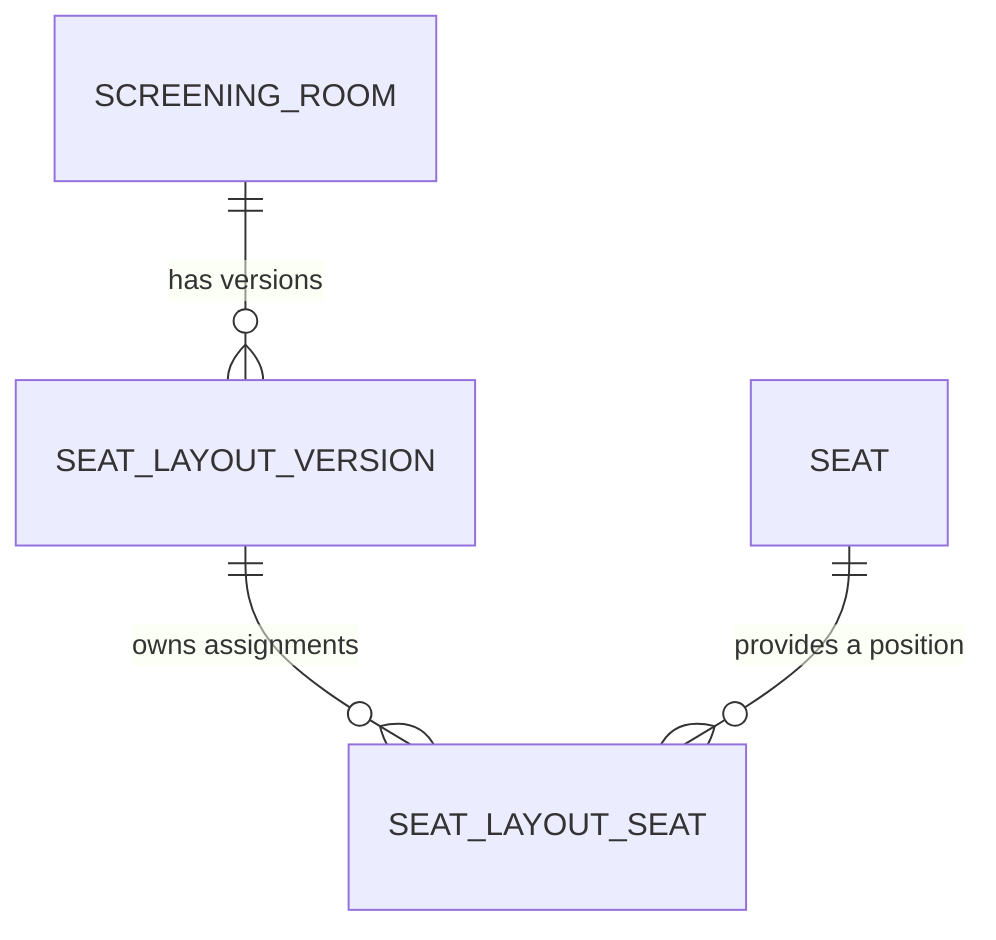

# Cinema seating model

## Relationships and ownership

Seat is a shared, immutable catalog position, with an explicitly supplied nonempty
GUID, a single ASCII row letter A–Z and a column from 1 through 100. Its factory
trims and uppercases rows; Label combines Row and the invariant Column representation.
Label is not persisted. Catalog positions are globally unique by Row and Column.

No catalog rows, seed mechanism or write API are introduced in this change.
Future seeding can supply stable GUIDs to Seat.Create(id, row, column).
A fresh catalog remains empty until a separate data-population task is completed.

SeatLayoutSeat is an audited entity with its own generated UUIDv7 ID, required
SeatLayoutVersionId and SeatId, and Category (Standard, Vip or Couple). It stores
no position copies. The same catalog A1 can be selected in multiple rooms and
layout versions, with different categories in each assignment.

A Couple assignment represents one bookable position with one category price.
Future booking references should identify the layout assignment rather than the
shared catalog position; booking entities are outside this change.

## Domain operations

SeatLayoutVersion retains its read-only Seats collection, now containing
SeatLayoutSeat assignments backed by the private _seats list.

- AddSeat(Seat seat, SeatCategory category) selects a catalog position and returns
  its new assignment. Duplicate SeatId values within one layout are rejected.
- ChangeSeatCategory(Guid layoutSeatId, SeatCategory category) updates an assignment
  identified by its assignment ID, not its catalog SeatId.
- RemoveSeat(Guid layoutSeatId) removes that assignment without mutating the catalog.
- Missing, empty or foreign assignment IDs are rejected.
- All edits require Draft status. To replace a selected position, remove its
  assignment and add the new position.
- Publishing requires at least one assignment and normalizes PublishedAt to UTC.
  Published and Archived layouts retain their selections and categories permanently.
  Room version numbers and publication/archive transitions retain existing behavior.

Showtime.OpenSales requires the complete assigned layout's Seats assignment
collection. Exact distinct category coverage is checked against assignment Category,
without requiring catalog Seat navigations to be loaded. Schedule changes, layout
selection, archived-layout retention and price immutability retain their existing rules.

Domain methods select existing catalog entities; they do not query the database.
Future persistence callers must load or attach selected Seat entities as existing
and unchanged rather than inserting them through an added layout graph. UI reads
that need labels should load or project assignment.Seat.Row/Column/Label explicitly.

## EF mapping and deployment

The cinema schema uses plural PascalCase table names and PascalCase columns. Seat and
SeatLayoutSeat retain the shared audited Entity<Guid> conventions. UUID primary keys
use ValueGeneratedNever; the Domain supplies their values.

| Table | Mapping |
| --- | --- |
| Seats | Id, Row varchar(1), Column integer, inherited audit columns; unique (Row, Column); Row matches ^[A-Z]$; Column between 1 and 100 |
| SeatLayoutSeats | Id, SeatLayoutVersionId, SeatId as uuid; Category as smallint constrained to 0, 1, 2; inherited audit columns |
| SeatLayoutVersions | Existing room/version/status/timestamp mapping and _seats field access retained; collection now contains assignments |

Assignments have a unique (SeatLayoutVersionId, SeatId) index and an explicit SeatId
index. The composite unique index covers layout foreign-key lookups because the
DbContext disables automatic foreign-key indexes.

The layout-to-assignment foreign key uses Cascade, including orphan deletion when
tracked assignments are removed from a required relationship. The assignment-to-Seat
foreign key uses Restrict, protecting referenced catalog rows. Seat has no inverse
assignment collection. ScreeningRoom relationships and Showtime's composite
layout/room foreign key remain unchanged.

BookingSystemCinemaDbContext exposes Seats and SeatLayoutSeats. Its existing
configuration assembly scanning discovers both mappings.

No schema migration or database operation is included. Before deploying these models,
a separate migration must update Seats and create SeatLayoutSeats, including renaming
existing lowercase tables to PascalCase. Quote table and column identifiers in
PostgreSQL SQL, for example `cinema."Seats"`. If a database
contains old layout-owned Seat rows, that migration must deduplicate Row/Column
positions, preserve layout/category assignments and account for any existing external
references. Existing out-of-range positions require an explicit data-conversion
decision. No database state was inspected or modified.

## Acceptance scenarios recorded for later execution

- " a " and column 1 normalize to A1; Z100 is valid.
- AA1, A0, A101, empty/nonalphabetic/non-ASCII rows and empty catalog IDs are rejected.
- One catalog A1 can belong to assignments in multiple rooms and versions.
- A1 can be Standard in one layout and Vip in another.
- Selecting the same catalog SeatId twice within a layout fails.
- Removing a Draft assignment leaves its catalog position available.
- Category changes and removal use assignment IDs; foreign/missing IDs fail.
- Undefined categories fail; Published/Archived assignment edits fail.
- Empty layouts cannot be published.
- Opening sales requires exact category-price coverage from the complete assignments.
- Existing showtimes retain their assigned layout, categories and pricing rules.

These scenarios are documentation only. No tests were added or executed. Completion
used source/diff review only, with no seed data, migration, restore, build, formatter,
Docker execution, migration execution or verification loop.
